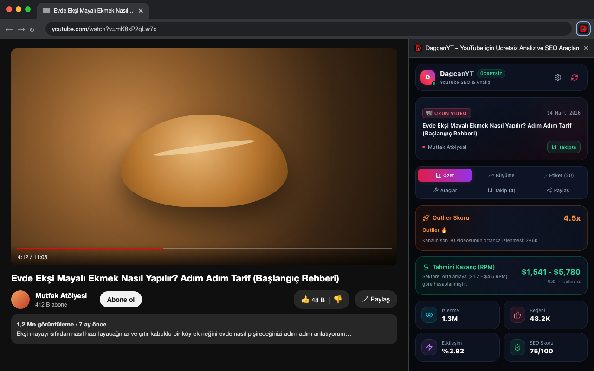
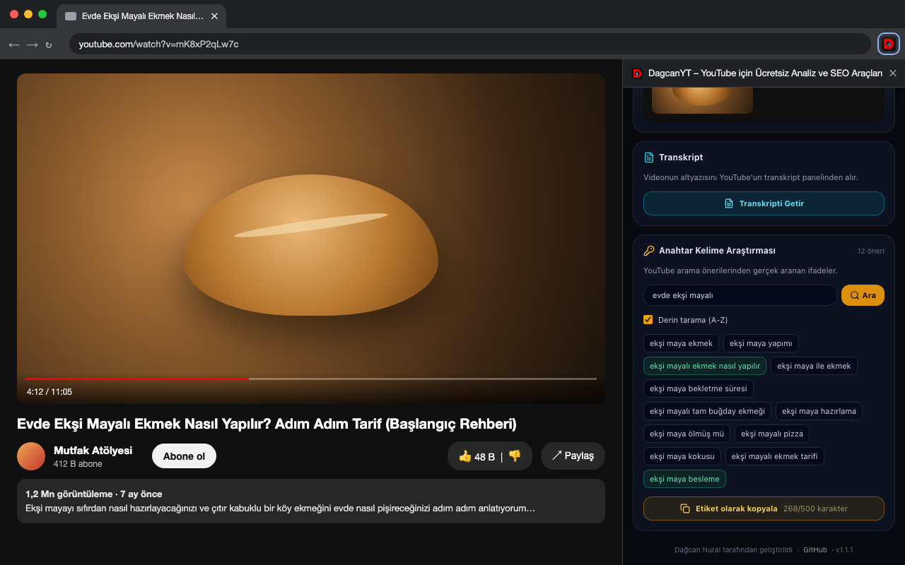
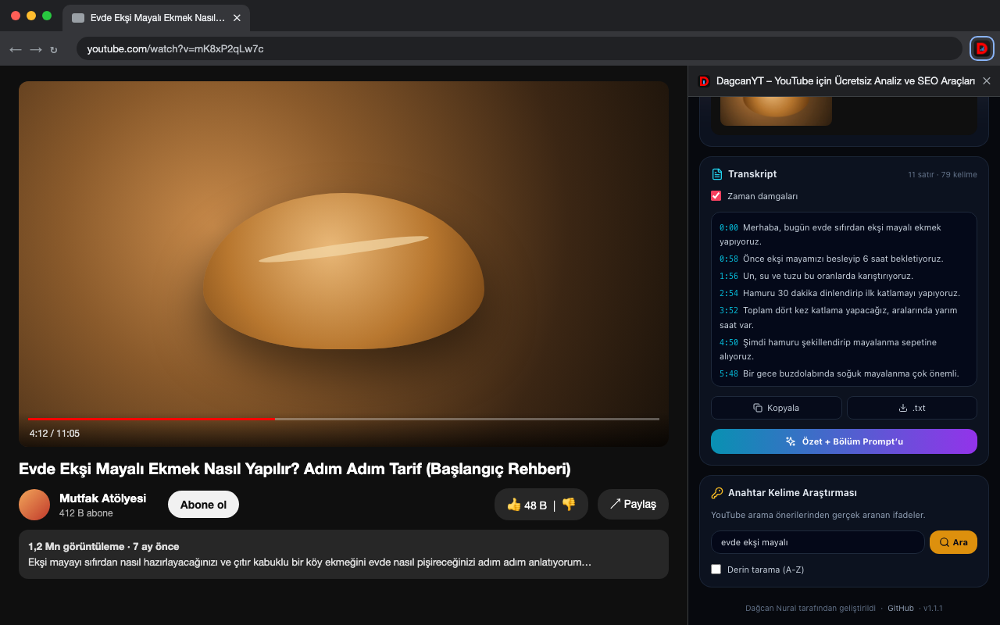
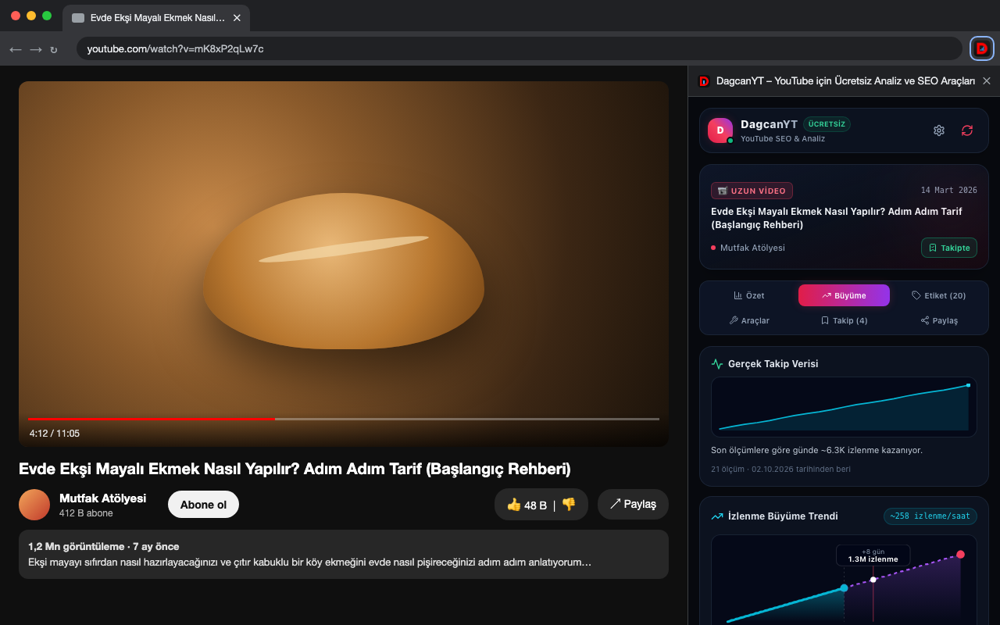
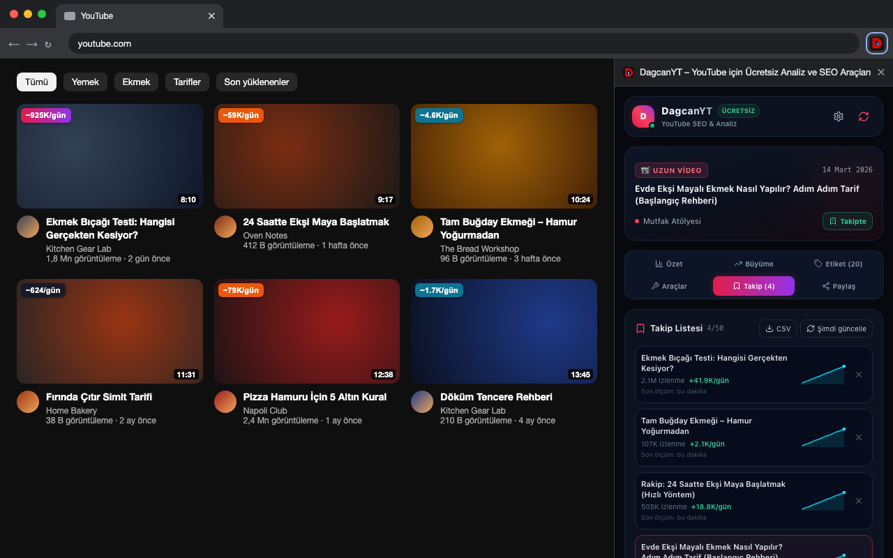

# DagcanYT – YouTube Analiz & SEO Aracı

**Ücretsiz Chrome eklentisi.** YouTube videolarının gizli etiketlerini, outlier skorunu, tahmini gelirini, transkriptini ve anahtar kelime fikirlerini Chrome'un yan panelinde gösterir. Hesap yok, abonelik yok, reklam yok; her şey tarayıcında çalışır.

🇬🇧 [English summary below](#english)



---

## İçindekiler

- [Özellikler](#özellikler)
- [Ekran görüntüleri](#ekran-görüntüleri)
- [Kurulum (kullanıcılar için)](#kurulum-kullanıcılar-için)
- [Nasıl kullanılır](#nasıl-kullanılır)
- [Güncelleme](#güncelleme)
- [Sorun giderme](#sorun-giderme)
- [Geliştiriciler için: komutlar](#geliştiriciler-için-komutlar)
- [Proje yapısı](#proje-yapısı)
- [Gizlilik](#gizlilik)

---

## Özellikler

| | Özellik | Açıklama |
|---|---|---|
| 🚀 | **Outlier skoru** | Video, kanalın son 30 videosunun ortanca izlenmesinin kaç katı? `4.5x` = outlier, `10x+` = viral |
| 💵 | **Tahmini kazanç** | RPM ortalamalarına göre gelir aralığı (uzun video ve Shorts ayrı) |
| 📊 | **Metrikler** | İzlenme, beğeni, etkileşim oranı, SEO sağlık skoru |
| 🏷️ | **Gizli etiketler** | Videonun izleyiciden gizlenen etiketleri: ara, tek tıkla kopyala |
| 🤖 | **AI prompt'ları** | Claude veya ChatGPT'ye yapıştırmak için hazır SEO analizi ve transkript özeti prompt'ları |
| 🔑 | **Anahtar kelime araştırması** | Gerçek YouTube arama önerileri, A–Z derin tarama, 500 karakter sınırına uyan "etiket olarak kopyala" |
| 📝 | **Transkript** | Altyazıyı zaman damgalı ya da damgasız kopyala veya `.txt` olarak indir |
| 🖼️ | **Thumbnail aracı** | Küçük resmi 4 boyutta indir, ana sayfa akışında nasıl göründüğünü koyu ve açık temada önizle |
| 🔥 | **Thumbnail rozetleri** | YouTube ana sayfasında, aramada ve önerilenlerde her videoda günlük izlenme; kanal sayfalarında outlier oranı |
| 📈 | **Takip listesi** | 50 videoya kadar izlenmeyi 3 saatte bir otomatik kaydeder: gerçek büyüme grafiği ve CSV dışa aktarma |
| 📤 | **Paylaş** | Instagram hikayesi boyutunda analiz kartı (PNG), WhatsApp ve X paylaşımı |
| 🌐 | **Türkçe / İngilizce** | Ayarlardan değiştirilebilir, varsayılan olarak tarayıcı dilini izler |

---

## Ekran görüntüleri

### 1. Özet: outlier skoru, tahmini kazanç ve metrikler
Videoyu açtığın anda yan panel doldurulur. Outlier skoru, videonun kanalın kendi ortalamasına göre ne kadar iyi gittiğini gösterir.


### 2. Araçlar: anahtar kelime araştırması
Konu yaz, **Ara**'ya bas. *Derin tarama (A-Z)* açıkken ifadenin sonuna her harfi ekleyerek yüzlerce öneri toplar. Yeşil olanlar videoda zaten var. **Etiket olarak kopyala**, YouTube'un 500 karakterlik etiket kutusuna sığacak kadarını kopyalar.



### 3. Araçlar: transkript
**Transkripti Getir**, YouTube'un kendi transkript panelini açar ve metni okur. Kopyala, `.txt` indir veya "Özet + Bölüm Prompt'u" ile AI'dan özet, bölümler ve Shorts fikirleri iste.



### 4. Büyüme: gerçek takip verisi ve projeksiyon
Takibe aldığın videolar için eklentinin ölçtüğü gerçek izlenmeler; altında ortalama hıza göre 30 günlük projeksiyon.



### 5. Thumbnail rozetleri ve takip listesi
YouTube ana sayfasında her videonun üstünde günlük izlenme hızı. Renkler: 🟣 100K+/gün · 🟠 10K+ · 🔵 1K+ · ⚫ daha az. Sağda takip listesi.



---

## Kurulum (kullanıcılar için)

Eklenti şu anda Chrome Web Mağazası'nda değil; GitHub'dan indirip 1 dakikada kurabilirsin. Chrome, Edge, Brave ve Opera gibi Chromium tabanlı tarayıcılarda çalışır.

1. **İndir:** [Releases](https://github.com/dagcann34/YoutubeAnalyse/releases/latest) sayfasından `dagcanyt-v1.1.1.zip` dosyasını indir.
2. **Zip'i aç:** Dosyaya çift tıkla. `dagcanyt-v1.1.1` adında bir klasör oluşur. Bu klasörü silinmeyecek bir yere taşı (ör. `Belgeler`), çünkü Chrome eklentiyi her açılışta bu klasörden yükler.
3. **Eklentiler sayfasını aç:** Adres çubuğuna `chrome://extensions` yaz ve Enter'a bas.
4. **Geliştirici modunu aç:** Sağ üstteki **Geliştirici modu** anahtarını aç.
5. **Yükle:** Sol üstte beliren **Paketlenmemiş öğe yükle** butonuna tıkla ve 2. adımdaki klasörü seç (içinde `manifest.json` olan klasör).
6. **Sabitle:** Araç çubuğundaki 🧩 simgesine tıkla, **DagcanYT**'nin yanındaki 📌 iğneye bas.
7. **Kullan:** YouTube'da bir video aç ve araç çubuğundaki DagcanYT simgesine tıkla. Yan panel açılır.

> ℹ️ Kurulumdan önce açık olan YouTube sekmelerini bir kez yenile (F5); eklenti yalnızca yeni yüklenen sayfalara bağlanır.

> ℹ️ Chrome açılışta "Geliştirici modu uzantılarını devre dışı bırak" uyarısı gösterebilir. Mağaza dışından kurulan her eklentide görünür; **İptal** / kapat diyerek devam edebilirsin.

---

## Nasıl kullanılır

| Sekme | Ne yapılır |
|---|---|
| **Özet** | Outlier skoru, tahmini kazanç ve metrikler. Kanal adının yanındaki **Takibe Al** butonu videoyu takip listesine ekler. |
| **Büyüme** | Takipteki videolar için gerçek ölçümler; tüm videolar için ortalama hıza göre 30 günlük projeksiyon. Grafiğin üstünde gezinince gün gün değer görünür. |
| **Etiket** | Gizli etiketler. Bir etikete tıklayınca kopyalanır, **Tümünü Kopyala** hepsini virgülle kopyalar. Altta AI analiz prompt'u var. |
| **Araçlar** | Thumbnail indirme/önizleme, transkript ve anahtar kelime araştırması. |
| **Takip** | Takip listesi: kazanılan günlük izlenme, mini grafik, **CSV** dışa aktarma, **Şimdi güncelle**. Videoya tıklayınca yeni sekmede açılır. |
| **Paylaş** | 1080×1920 PNG analiz kartı, WhatsApp ve X paylaşımı. |

**Ayarlar (⚙ simgesi):**
- **Dil:** Otomatik / TR / EN
- **Thumbnail rozetleri:** YouTube sayfalarındaki rozetleri aç/kapat

**Notlar:**
- Rozetler ve outlier skoru, YouTube arayüzü **Türkçe veya İngilizce** olduğunda çalışır (YouTube sayıları dile göre kısaltarak yazar).
- Transkript, yalnızca YouTube'un "Transkripti göster" seçeneği olan videolarda vardır.
- Tahmini kazanç sektör ortalamasına dayanan bir tahmindir; gerçek gelir kanala, ülkeye ve konuya göre değişir.

---

## Güncelleme

1. [Releases](https://github.com/dagcann34/YoutubeAnalyse/releases) sayfasından yeni zip'i indir ve aç.
2. Eski klasörün içeriğini yenisiyle değiştir (aynı klasör yolunu kullan).
3. `chrome://extensions` sayfasında DagcanYT kartındaki **↻ (yenile)** butonuna bas.

Takip listen ve ayarların korunur. Eklentiyi **kaldırırsan** silinir.

---

## Sorun giderme

| Sorun | Çözüm |
|---|---|
| Panel "Sayfayla bağlantı kurulamadı" diyor | YouTube sekmesini yenile (F5). |
| Panel boş / "YouTube Videosu Bekleniyor" | Bir video sayfasında olduğundan emin ol (`/watch?v=` veya `/shorts/`). |
| `chrome://extensions` kartında hata, `localhost:5173` geçiyor | Klasör bir geliştirme derlemesi. Releases'tan zip'i indir ya da `npm run build` çalıştır (aşağıya bak). |
| Rozetler görünmüyor | ⚙ Ayarlar'da açık mı? YouTube dili Türkçe/İngilizce mi? Sayfayı yenile. |
| Outlier skoru "hesaplanamadı" | Kanalın yeterli (3+) videosu yoksa veya YouTube dili TR/EN değilse hesaplanamaz. |
| "Paketlenmemiş öğe yükle" görünmüyor | Sağ üstteki **Geliştirici modu** anahtarını aç. |

---

## Geliştiriciler için: komutlar

Gereksinimler: **Node.js 18+** ve npm.

```bash
git clone https://github.com/dagcann34/YoutubeAnalyse.git
cd YoutubeAnalyse
npm install
```

| Komut | Ne yapar |
|---|---|
| `npm run build` | Tip kontrolü (`tsc`) + production derlemesi → `dist/`. Chrome'a yüklenecek klasör budur. |
| `npm run dev` | İzleme modunda derler: dosya kaydettikçe `dist/` yeniden oluşur. `chrome://extensions` → ↻ ile yenile. Sunucuya ihtiyaç duymaz. |
| `npm run dev:hmr` | Vite geliştirme sunucusu (anında yenileme). ⚠️ Bu moddayken `dist/` sunucuya bağımlıdır; sunucu kapanınca eklenti hata verir. Bitince `npm run build` çalıştır. |
| `npm run zip` | Production derlemesi + `release/dagcanyt-v<sürüm>.zip` paketi (GitHub Release ve Chrome Web Mağazası için). |
| `npm run screenshots` | `design/store-screenshots/` altındaki TR/EN ekran görüntülerini mevcut derlemeden yeniden üretir (önce `npm run build`; Google Chrome gerekir). |

**Geliştirme döngüsü:**

```bash
npm run dev            # terminalde açık kalsın
# chrome://extensions → Paketlenmemiş öğe yükle → dist/ klasörünü seç
# kodu değiştir → kaydet → chrome://extensions'ta ↻ → YouTube sekmesini yenile
```

**Yeni sürüm yayınlama:**

```bash
# 1) manifest.json ve package.json içindeki "version" değerini artır (ör. 1.2.0)
npm run zip
gh release create v1.2.0 release/dagcanyt-v1.2.0.zip --title "DagcanYT v1.2.0" --notes "Değişiklikler..."
```

---

## Proje yapısı

```
├── manifest.json              # Chrome MV3 manifest (izinler, side panel, content script)
├── public/
│   ├── _locales/{en,tr}/      # Mağaza adı ve açıklaması (TR/EN)
│   └── icon-*.png
├── src/
│   ├── background/index.ts    # Service worker: side panel davranışı, takip listesi alarmı
│   ├── content/
│   │   ├── index.ts           # YouTube sayfasından veri okuma, transkript, kanal istatistikleri
│   │   └── badges.ts          # Thumbnail rozetleri
│   ├── sidepanel/             # React yan panel arayüzü (App, components/, tools/)
│   ├── i18n/index.ts          # Tüm TR/EN metinler
│   └── utils/                 # Hesaplamalar, ayarlar, takip listesi, YouTube metin ayrıştırıcıları
├── design/                    # Logo, tanıtım görseli, ekran görüntüleri ve üretim betiği
└── store/                     # Chrome Web Mağazası metinleri ve gizlilik politikası
```

Teknolojiler: TypeScript, React 18, Tailwind CSS, Vite + [@crxjs/vite-plugin](https://crxjs.dev/vite-plugin).

**İzinler:** `sidePanel` (arayüz), `storage` (ayarlar ve takip listesi, yalnızca cihazda), `alarms` (takip listesini 3 saatte bir güncelleme), `www.youtube.com` (video verisi), `i.ytimg.com` (thumbnail indirme), `suggestqueries.google.com` (anahtar kelime önerileri).

---

## Gizlilik

DagcanYT'nin sunucusu yoktur. Kişisel veri toplamaz, analiz veya reklam aracı kullanmaz. Ayarlar ve takip listesi yalnızca senin tarayıcında saklanır. Ayrıntılar: [Gizlilik Politikası](store/privacy-policy.html).

DagcanYT bağımsız bir araçtır; YouTube veya Google ile bağlantılı değildir.

İletişim: dagcannural7@gmail.com

---

## English

**DagcanYT** is a free Chrome extension that shows YouTube analytics and SEO data in Chrome's side panel: outlier score vs. the channel median, estimated earnings, hidden tags, keyword research from YouTube search suggestions, transcripts, thumbnail download and preview, views-per-day badges on YouTube thumbnails, and a tracking list that records real view growth. English and Turkish UI. No account, no server, no ads.

**Install:** download `dagcanyt-v1.1.1.zip` from [Releases](https://github.com/dagcann34/YoutubeAnalyse/releases/latest) and unzip it. Then open `chrome://extensions`, turn on **Developer mode**, click **Load unpacked** and select the unzipped folder. Pin the extension, open a YouTube video and click the DagcanYT icon.

**Develop:** `npm install`, then `npm run build` (output in `dist/`), `npm run dev` (watch build), `npm run zip` (release package). Screenshots: [design/store-screenshots/en](design/store-screenshots/en).
